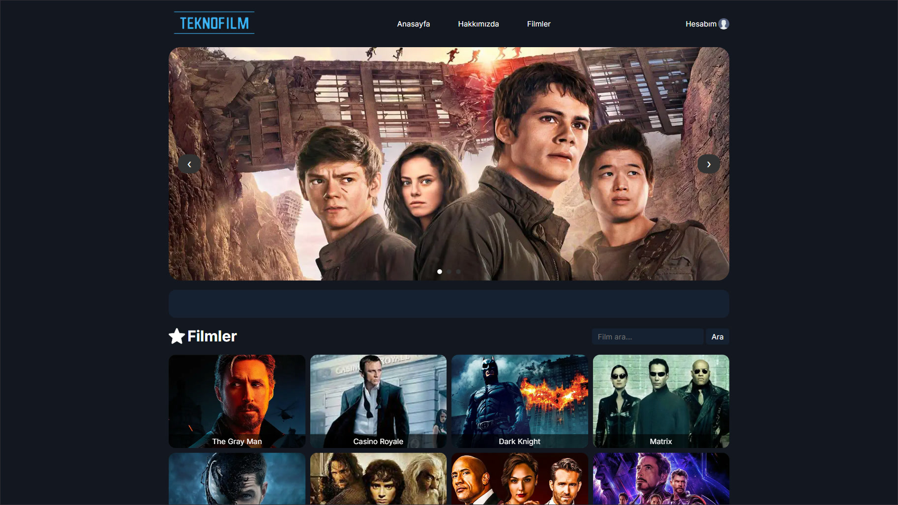
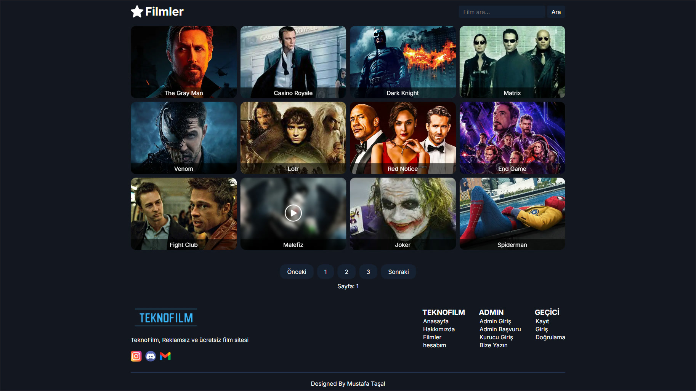
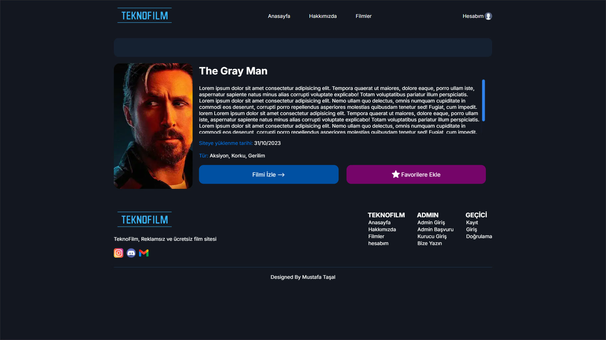
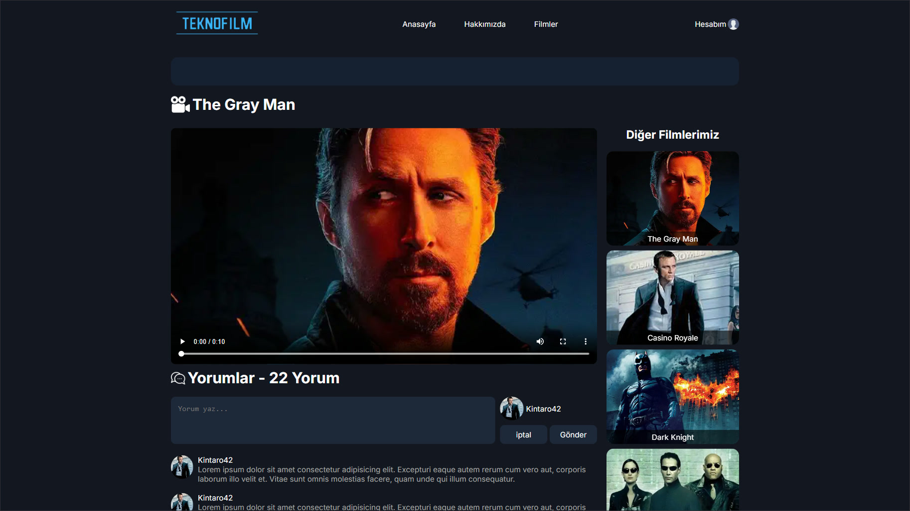
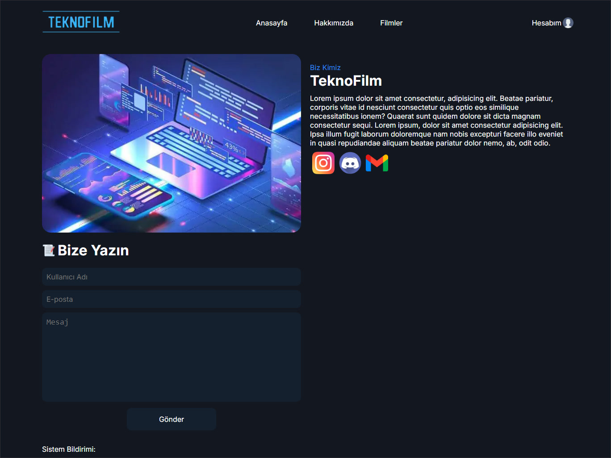
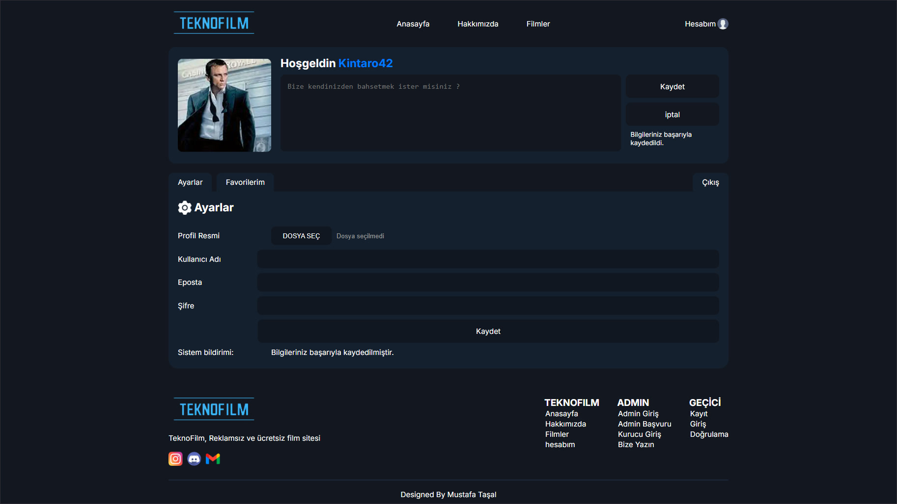
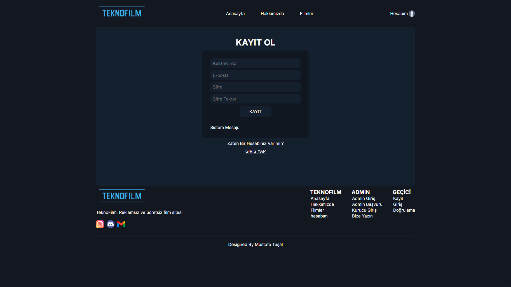
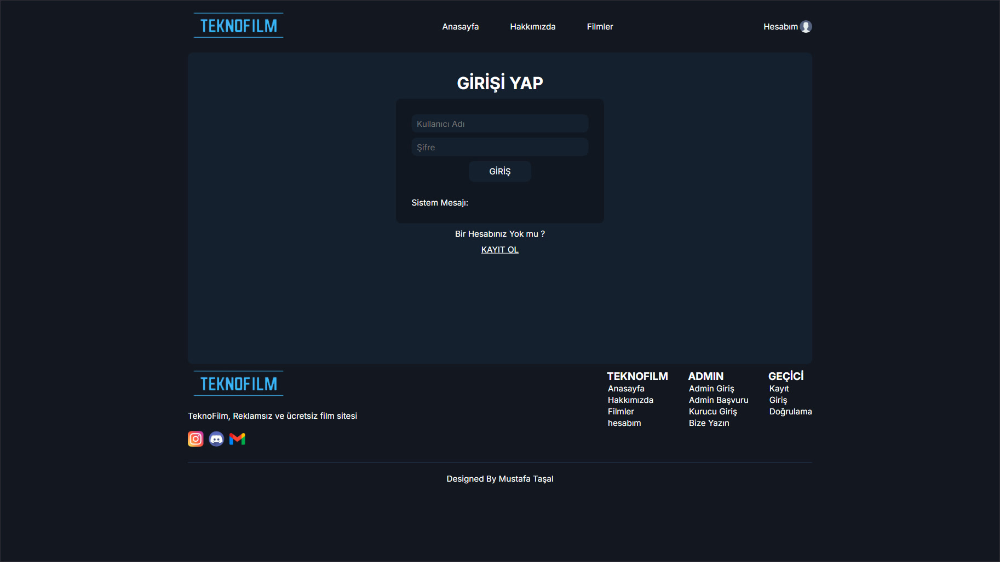
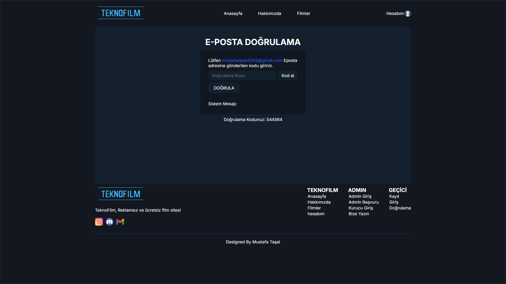

<a href="README.md">
  
</a>
<a href="README-TR.md">
  
</a>

  <br />
  <br />

<div align="center">
  
  <br />
  <br />

  <p>
     HTML, CSS ve JavaScript ile hazırlanmış bir film sitesi arayüzü.
  </p>


  <p>
    <a href="#demo">Demo</a> •
    <a href="#info">Bilgilendirme</a> •
    <a href="#about">Hakkında</a> •
    <a href="#features">Özellikler</a> •
    <a href="#tech">Teknolojiler</a> •
    <a href="#setup">Kurulum</a> •
    <a href="#gallery">Galeri</a>
  </p>

  <br />
  <br />
</div>

## <a id="demo"></a> 📷 Demo

- [https://xkintaro.github.io/teknofilm-html/](https://xkintaro.github.io/teknofilm-html/)

## <a id="info"></a> 📌 Bilgilendirme

Sitedeki film afişleri ve banner görselleri ilgili hak sahiplerine aittir. Yalnızca arayüzü göstermek amacıyla kullanılmıştır ve projenin ticari bir amacı yoktur.

## <a id="about"></a> 📋 Hakkında

Bu web sitesi, yazdığım ilk güzel arayüze sahip projeydi. Bu noktada artık HTML ve CSS ile istediğim gibi şeyler yapabilmeye başlamıştım. Zaten bu projeden sonra da backend geliştirmeye de başladım. Bu siteyi bir anı ve arşiv olarak kalması için buraya da yüklüyorum.

**TEKNOFILM**, ana sayfadan film sayfalarına ve hesap sayfalarına kadar bir film sitesinin arayüzüdür. Site yalnızca ön yüzden oluşur. Formlar, arama kutusu ve yorumlar herhangi bir backend'e bağlı değildir.

## <a id="features"></a> ✨ Özellikler

- **Ana sayfa**: 5 saniyede bir değişen bir banner slider'ı ve altında film kartlarından oluşan bir ızgara.
- **Film sayfaları**: Favorilere ekleme butonu olan bir film bilgi sayfası ile video oynatıcısı ve yorumlar bölümü olan bir izleme sayfası.
- **Hesap sayfaları**: Giriş, kayıt ve e-posta doğrulama formları ile ayarlar ve favoriler arasında geçiş yapılabilen bir hesap sayfası.
- **Hakkımızda sayfası**: Site hakkında bilgiler ve bir iletişim formu.
- **Duyarlı tasarım**: Düzen küçük ekranlara uyum sağlar ve menü, küçük ekranlarda bir menü butonuna dönüşür.

## <a id="tech"></a> 🛠️ Teknolojiler

`HTML` · `CSS` · `JavaScript`

## <a id="setup"></a> 🚀 Kurulum

### Adım Adım Kurulum

1. **Depoyu klonlayın**

   ```bash
   git clone https://github.com/xkintaro/teknofilm-html.git
   cd teknofilm-html
   ```

2. **Siteyi açın**

   `index.html` dosyasını tarayıcınızda açın.

## <a id="gallery"></a> 🖼️ Galeri



















#

<p align="center">
  <sub>❤️ Developed by "Mustafa TAŞAL" (kintaro)</sub>
</p>
