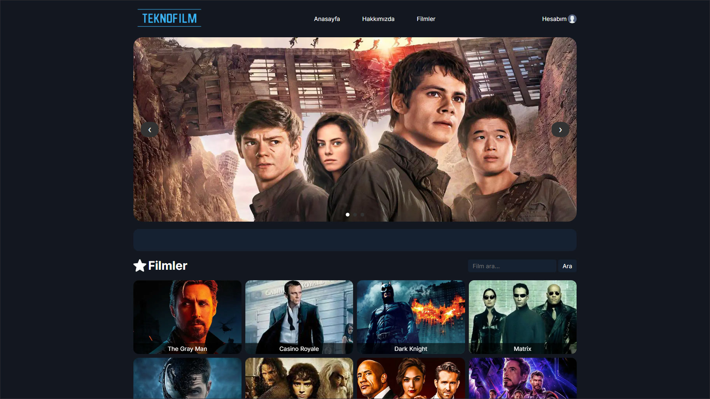

<a href="README.md">
  
</a>
<a href="README-TR.md">
  
</a>

  <br />
  <br />

<div align="center">
  
  <br />
  <br />

  <p>
     A movie website interface built with HTML, CSS, and JavaScript.
  </p>


  <p>
    <a href="#demo">Demo</a> •
    <a href="#info">Info</a> •
    <a href="#about">About</a> •
    <a href="#features">Features</a> •
    <a href="#tech">Tech</a> •
    <a href="#setup">Setup</a> •
    <a href="#gallery">Gallery</a>
  </p>

  <br />
  <br />
</div>

## <a id="demo"></a> 📷 Demo

- [https://xkintaro.github.io/teknofilm-html/](https://xkintaro.github.io/teknofilm-html/)

## <a id="info"></a> 📌 Info

The movie posters and banner images on this site belong to their respective owners. They are used only to show the interface, and the project is not intended for commercial use.

## <a id="about"></a> 📋 About

This website was the first project where I built a well-designed interface. At that point, I had started to create what I wanted using HTML and CSS. After this project, I also began learning backend development. I’m uploading it here to keep it as a memory and an archive.

**TEKNOFILM** is the interface of a movie website, from the home page and movie pages to the account pages. The site is front-end only. The forms, search box, and comments are not connected to a backend.

## <a id="features"></a> ✨ Features

- **Home page**: A banner slider that changes every 5 seconds, followed by a grid of movie cards.
- **Movie pages**: A movie details page with a favorites button, and a watch page with a video player and a comments section.
- **Account pages**: Login, sign-up, and email verification forms, plus an account page that switches between settings and favorites.
- **About page**: Information about the site and a contact form.
- **Responsive design**: The layout adapts to smaller screens, and the navigation collapses into a menu button.

## <a id="tech"></a> 🛠️ Tech

`HTML` · `CSS` · `JavaScript`

## <a id="setup"></a> 🚀 Setup

### Step-by-Step Installation

1. **Clone the repository**

   ```bash
   git clone https://github.com/xkintaro/teknofilm-html.git
   cd teknofilm-html
   ```

2. **Open the site**

   Open `index.html` in your browser.

## <a id="gallery"></a> 🖼️ Gallery




#

<p align="center">
  <sub>❤️ Developed by "Mustafa TAŞAL" (kintaro)</sub>
</p>
