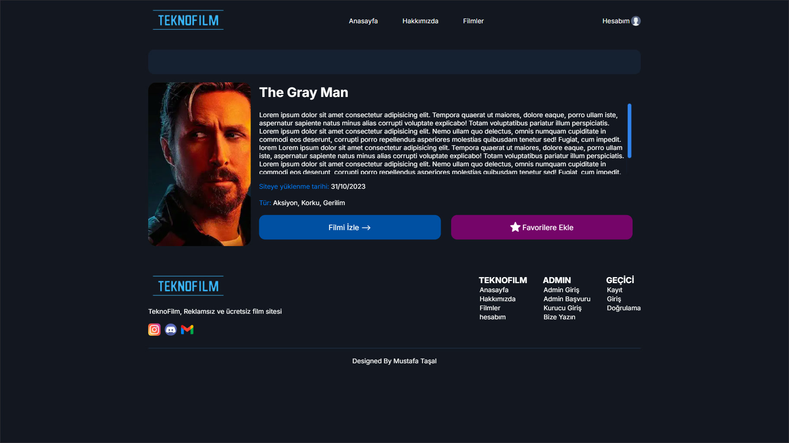
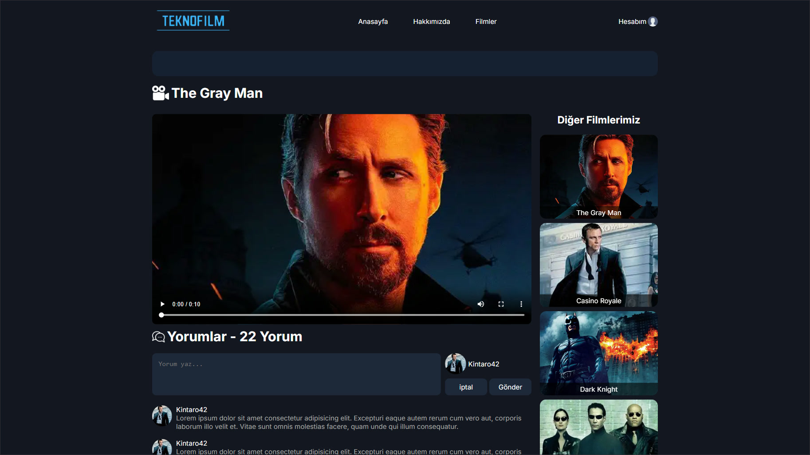
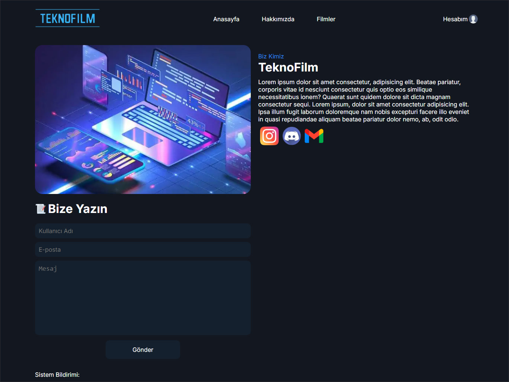
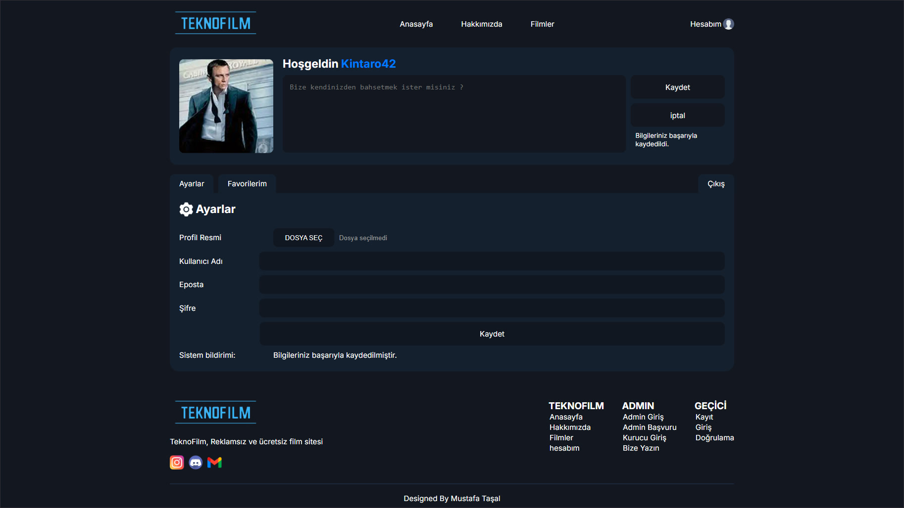
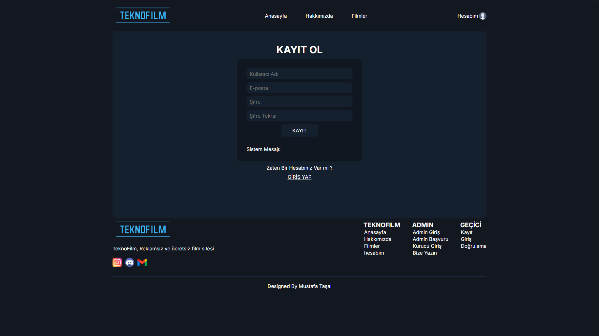
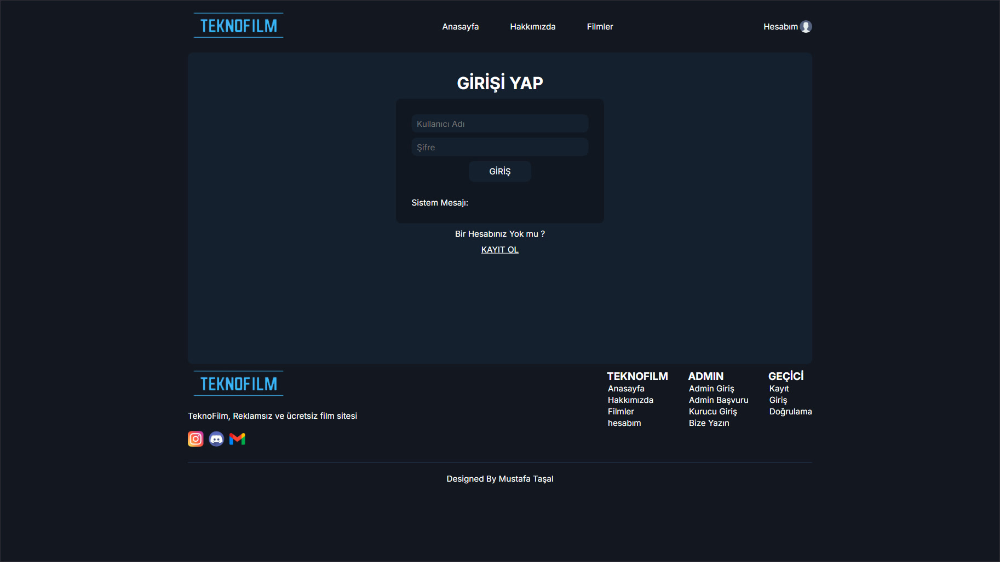

## 📷 Demo Link

- [https://xkintaro.github.io/teknofilm-html/](https://xkintaro.github.io/teknofilm-html/)

## 📋 About

**EN - ENGLISH**

This website was the first project where I built a well-designed interface. At that point, I had started to create what I wanted using HTML and CSS. After this project, I also began learning backend development. I'm uploading it here to keep it as a memory and an archive.

#

**TR - TÜRKÇE**

Bu web sitesi, yazdığım ilk güzel arayüze sahip projeydi. Bu noktada artık HTML ve CSS ile istediğim gibi şeyler yapabilmeye başlamıştım. Zaten bu projeden sonra da backend geliştirmeye de başladım. Bu siteyi bir anı ve arşiv olarak kalması için buraya da yüklüyorum.

## 🛠️ Technologies

## 🖼️ Gallery

#

#

#

#

#

#

#

#

